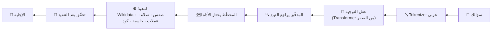

<p align="center"></p>

<p align="center">
  <a href="https://sadah-app.vercel.app"><b>🌐 جرّب سَداة الآن</b></a> ·
  <a href="#كيف-يشتغل">كيف يشتغل</a> ·
  <a href="#شغّله-على-جهازك">شغّله على جهازك</a> ·
  <a href="#english">English</a>
</p>

---

## وش هي سَداة؟

**سَداة** مساعدة ذكاء اصطناعي عربية، **عقلها مبني ومُدرَّب من الصفر بالكامل**: ما تستخدم ChatGPT ولا Gemini ولا أي نموذج جاهز أو واجهة ذكاء خارجية. كل معامل في عقلها تدرّب هنا، والكود كله في هذا المستودع.

الاسم من **السَّداة**: الخيوط الطولية اللي تنشدّ على النول قبل النسج، وعليها يقوم كل نقش في **السدو** البدوي. وكذا سَداة: أساس متين تنسج عليه الإجابة، تفهم السؤال بعقلها الخاص ثم تجيب المعلومة من أدوات موثوقة.

| تسأل | سَداة ترد |
|---|---|
| كيف الجو في الرياض؟ | الطقس الحالي والعظمى والصغرى |
| متى أذان المغرب في جدة؟ | مواقيت الصلاة اليوم |
| كم 100 دولار بالريال؟ | سعر الصرف الحي (49 عملة) |
| كم سعر الذهب عيار 21؟ | أسعار الذهب والفضة والعملات الرقمية لحظياً |
| حل x² − 5x + 6 = 0 | الحل مع التحقق بالتعويض |
| كيف أعكس نص في بايثون؟ | كود جاهز ومختبر (45 مهمة × 6 لغات) |
| ما هي عاصمة اليابان؟ | إجابة من Wikidata وويكيبيديا ومكتبة معرفة محلية |
| سوّ لي سيرة ذاتية | يقرأ ملفاتك (بدون حفظها) ويطلع سيرة جاهزة للطباعة |

## كيف يشتغل



| الجزء | وش يسوي | المجلد |
|---|---|---|
| **عقلا التصنيف** | عقل يحدد نوع السؤال (12 مهارة) وعقل للبرمجة. 13.58 مليون معامل، تعلّم مسبق ذاتي (BPE + MLM) على ويكيبيديا ثم نقل تعلّم | `core/` |
| **العقل التوليدي** | GPT بحجم **335 مليون معامل** يتدرّب الآن من الصفر على ويكيبيديا العربية، ليكتب الردود بنفسه | `core/gpt.py` · `gpu/` |
| **الوكيل** | المخطّط والمدقّق وكل الأدوات الدقيقة (حقائق، بحث، رياضيات، أسواق، صلاة، ترجمة) | `agent/` |
| **السيرة الذاتية** | استخراج الحقول من PDF/Word وتوليد سيرة عربية أو إنجليزية | `cv/` |
| **الواجهة** | HTML/CSS/JS بدون مكتبات، عربي أولاً، فاتح وداكن، بهوية فاخرة (ليلي وذهبي) مستوحاة من السدو | `ui/` |
| **الخادم** | FastAPI · `app.py`، منشور على Vercel، والعقل يشتغل فيه بـ NumPy بدون PyTorch | الجذر · `core/fast_brain.py` |

### أرقام صادقة

- الاختبار الرسمي: **310 / 310** · الاختبار المخفي (صيغ ما شافها العقل): **87.9%**
- العقل التوليدي بعد أول 12 ساعة تدريب: perplexity **14.0** على نصوص ما شافها. يكتب عربي سليم، لكنه **ما يسولف بعد** ومعلوماته لحاله غير موثوقة، والمعلومة الدقيقة تجي دائماً من الأدوات.

## شغّله على جهازك

**ويندوز:** اضغط مرتين على `launch_platform.bat`.

**يدوياً:**

```bash
pip install -r requirements-train.txt --extra-index-url https://download.pytorch.org/whl/cpu
python app.py          # http://localhost:8000
```

للخادم بس بدون تدريب: `pip install -r requirements.txt`. هذي النسخة بدون PyTorch، والعقل يشتغل بـ NumPy بنفس النتائج، وهي اللي تنشر على Vercel.

**تدريب العقل التوليدي** (مجاناً على كروت Kaggle): التفاصيل خطوة بخطوة في [`gpu/README.md`](gpu/README.md).

## الخصوصية والأمان

- لا تسجيل دخول، ولا تتبّع، ولا إعلانات.
- المحادثات تنحفظ في متصفحك فقط.
- ملفات السيرة الذاتية تُقرأ في الذاكرة ولا تُحفظ.
- تشغيل الأكواد وأوامر النظام متاح فقط لصاحب الجهاز؛ الزوار يحصلون حاسبة آمنة (AST).

## القاعدة الأساسية

> عقل سَداة مملوك 100% ومُدرَّب من الصفر. ممنوع ربطه بأي نموذج خارجي أو تحميل أوزان جاهزة، حتى لو كان أبطأ أو أصغر.

---

<a id="english"></a>

## English

**SADAH** (سَداة, the warp threads of the loom that every Bedouin *Al Sadu* pattern is woven on) is an Arabic AI assistant whose brain is **built and trained entirely from scratch**: no ChatGPT, no Gemini, no pretrained weights, no external AI API.

- **Live:** https://sadah-app.vercel.app
- **How it works:** a from-scratch Transformer routes each question to one of 12 skills; precise tools (Wikidata, Wikipedia, a local knowledge library, live markets, weather, prayer times, a safe math engine, a coding brain) produce the answer, checked before and after execution.
- **In training:** a 335M-parameter GPT trained from scratch on Arabic Wikipedia on free Kaggle GPUs (`core/gpt.py`, `gpu/`), to write the replies itself.
- **Run locally:** `pip install -r requirements-train.txt` then `python app.py` → http://localhost:8000 (server only, no PyTorch: `requirements.txt`; the brains then run on NumPy, as on Vercel)
- **Stack:** Python, PyTorch (training), NumPy (serving), FastAPI on Vercel, vanilla HTML/CSS/JS (RTL first).
