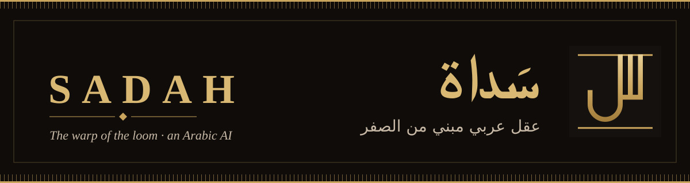

<p align="center"></p>

<p align="center">
  <a href="https://sadah-app.vercel.app"><b>🌐 جرّب سَداة الآن</b></a> ·
  <a href="#البنية-سَداة-20">البنية</a> ·
  <a href="#شغّلها-على-جهازك">شغّلها على جهازك</a> ·
  <a href="#english">English</a>
</p>

---

## المنشئ: من وصف عربي إلى مشروع جاهز

تحوّل سَداة طلبًا بالعربي إلى **موقع أو تطبيق صغير** تنزّله كملفات: صفحة هبوط، لوحة بيانات، متجر عرض (بلا دفع)، ملف أعمال، مدونة، دعوة فعالية، قائمة مهام، أو نموذج تسجيل. لا نموذج توليد ولا شبكة: فهم الطلب بقواعد، ثم قالب عربي RTL، ثم فحوص ساكنة قبل التسليم.

- من الواجهة: `/builder` · من الطرفية: `python -m builder "أبغى موقع لمطعم باسم بيت الشواء" --out site.zip`
- **حدوده الصريحة**: لا يبني تطبيقات جوال ولا دفع ولا قواعد بيانات ولا تسجيل دخول ولا دردشة ولا حجز؛ يعتذر بوضوح بدل أن يتجاهل الميزة بصمت، ويسأل عن الاسم إن لم يُذكر.
- **قياسه**: مجموعة تطوير تُضبط عليها القواعد + مجموعة محجوزة تُقاس مرة واحدة قبل أي تعديل. القياسات الأولى قبل الضبط: 75% ثم 80% ثم 87.5% ثم 100% (10/10) ثم 95% (19/20) في جولة الأنواع الجديدة، ثم 93% (13/14)، وبعدها تُنقل الحالات إلى مجموعة التطوير وتُكتب محجوزة جديدة.

---

## وش هي سَداة؟

**سَداة** مساعدة ذكاء اصطناعي عربية، **عقلها مبني ومُدرَّب من الصفر بالكامل**: لا نماذج خارجية ولا واجهات ذكاء اصطناعي جاهزة، والنص كله يمرّ من كود نملكه.

الاسم من **السَّداة**: الخيوط الطولية اللي تنشدّ على النول قبل النسج، وعليها يقوم كل نقش في **السدو** البدوي. وكذا سَداة: خيوط معرفة تنشدّ أولاً، ثم تُنسج منها الإجابة.

## البنية: سَداة 2.0

عشرون وكيلاً صغيراً، لكل وكيل قطاع، يتكلمون عبر **ناقل رسائل** (`agents/bus.py`) ويشتغلون بالتوازي مع مهلة لكل وكيل. المشرفة تخطّط، والباقي ينفّذ ويتحقق.

| القطاع | الوكلاء |
|---|---|
| القيادة والتواصل | المشرفة (Supervisor) · المرافقة (Companion) · المنسّقة (Stylist) |
| الأمان والنقد | المدقّق الأمني (Critic/Security) · بيئة التنفيذ المعزولة (Sandbox) |
| المعرفة والبحث | المكتبة المحلية (LocalKB) · ويكيبيديا · Wikidata · الويب المفتوح · التركيب (Synthesis) · الترجمة |
| الحساب | الرياضيات الرمزية · الرياضيات العددية · الوحدات · التاريخ والوقت |
| البيانات الحية | الصرف (Forex) · الأسواق (Markets) · الطقس والصلاة |
| البرمجة | مهندسة الكود (CodeArchitect) · مركّبة الكود (CodeSynthesizer) |

### كيف نضمن الجواب

- **الشهود (`agents/consensus.py`):** كل حقيقة تُقارن بمصدر ثانٍ مستقل (Wikidata × ويكيبيديا). النتيجة: ✅ مصدران متفقان، أو ℹ️ مصدر واحد، أو ⚠️ تعارض نقوله بصراحة.
- **التحقق العكسي:** كل وكيل يتأكد من نتيجته بطريقة ثانية: المعادلة تُعوَّض في نفسها، المشتقة تُقارن عددياً، التحويل يُعاد للوحدة الأصلية، والتواريخ تُعدّ مرتين.
- **محرك الأسباب (`agent/causal.py`):** أسئلة «ليش/لماذا» تُجاب بجمل تذكر السبب فعلاً، وإذا ما وُجد سبب مصرّح به تنخفض الثقة وتنكشف.
- **الذاكرة والضمائر (`agent/memory.py`):** «كم مساحته؟» بعد سؤال عن اليابان تتحول إلى «كم مساحة اليابان؟»، وإذا ما فيه موضوع سابق تسأل سَداة بدل أن تخمّن.
- **درع الحقائق:** قاموس محلي لأهم الدول والكيانات (`data/kb/facts_cache.json`) يجيب في أقل من ميلي ثانية بدون شبكة؛ وغير ذلك يمرّ على Wikidata عبر حارس (`agent/wd_guard.py`: ذاكرة مؤقتة، طلبان كحد أقصى، تراجع أُسّي، وقاطع دائرة)، وإذا تعذّر تقرأ سَداة الحقيقة بصمت من مقدمة ويكيبيديا أو المكتبة المحلية. ما فيه «بلا جواب» لسؤال معروف.

### العقول

عقل لتصنيف الطلب (12 مهارة) وعقل للبرمجة، ترانسفورمر مبني من الصفر مع محلّل BPE عربي وتعلّم مسبق ذاتي. تشتغل على الخادم بـ NumPy فقط، بنفس نتائج التدريب.

### الهوية: Royal Obsidian

واجهة HTML/CSS/JS بلا مكتبات، عربية أولاً: أسود حبري (`#080706`) وذهب (`#D4AF37`) وعنّابي (`#4A0E17`)، خط IBM Plex Sans Arabic، شعار **Loom Core** (خيوط وماسة بلا أي حرف)، ومقدمة 2.2 ثانية على المعالج الرسومي (`transform`/`opacity` فقط). تحت كل إجابة لوحة **مسار التفكير** تعرض من اشتغل، وكم كانت الثقة، وهل تحقق مصدران.

## بنية المجلدات

| المجلد | المحتوى |
|---|---|
| `agent/` | مهارات ووكلاء: الحقائق، الأسباب، الذاكرة، الرياضيات، الأسواق، الصلاة، الكود |
| `agents/` | الناقل والرسائل والمشرفة واتفاق الشهود |
| `core/` | العقول والمحلّل ومسار التدريب |
| `ui/` | الواجهة والمقدمة ولوحة المسار |
| `cv/` | السيرة الذاتية: قراءة الملفات وتوليد السيرة |
| `tests/` | اختبارات بلا شبكة (`shield_test`, `agents_test`, `sadah2_test*`, `sadah3_test`, `regression_*_test`) والاختبار الرسمي `benchmark` |
| `models/` | العقلان المخدومان `router.pt` و`coder.pt`، وسجل الإصدارات `registry/` وحدود البوابة `gate.json` |

كل ملف بايثون لا يزيد على 150 سطراً (يتحقق منه `tests.regression_gate_test`).

## التدريب الآمن: لا اعتماد بلا بوابة

التدريب لا يكتب فوق العقل المخدوم. ينتج مرشحًا في `models/registry/`، ثم **بوابة انحدار** تقارنه مع النسخة المستقرة مهارة بمهارة على أسئلة لا يُدرَّب عليها، وترفضه إذا تراجعت أي مهارة أكثر من الحد (`models/gate.json`). كل نسخة لها sha256 وسجل تدقيق ويمكن الرجوع إلى أي نسخة مستقرة.

```bash
python -m core.lifecycle init                         # مرة واحدة: تسجيل الأوزان الحالية كنسخة مستقرة
python -m core.lifecycle new-experiment my-exp --brain router --size pretrained --epochs 12
python -m core.trainer --experiment my-exp            # تدريب مرشح + حكم البوابة (exit 1 إن رُفض)
python -m core.lifecycle promote router 3             # اعتماد مرشح ناجح
python -m core.lifecycle rollback router              # رجوع للنسخة السابقة
python -m unittest tests.regression_gate_test tests.regression_registry_test   # اختبارات الانحدار
```

التفاصيل الكاملة (الأوامر، هيكل الحفظ، إضافة مهارة جديدة): [`docs/OPERATIONS.md`](docs/OPERATIONS.md).

## شغّلها على جهازك

**ويندوز:** اضغط مرتين على `launch_platform.bat`.

**يدوياً:**

```bash
pip install -r requirements.txt
python app.py          # http://localhost:8000
```

الاختبارات: `python -m unittest tests.regression_gate_test tests.regression_registry_test` و`python -m tests.shield_test` و`python -m tests.agents_test` و`python -m tests.sadah3_test`، والاختبار الرسمي `python -m tests.benchmark`.

## الخصوصية والأمان

- لا تسجيل دخول، ولا تتبّع، ولا إعلانات.
- المحادثات تنحفظ في متصفحك فقط، وأسئلة الزوار لا تُستخدم للتدريب أبداً.
- ملفات السيرة الذاتية تُقرأ في الذاكرة ولا تُحفظ.
- تشغيل الأكواد وأوامر النظام متاح فقط لصاحب الجهاز؛ الزوار يحصلون حاسبة آمنة (AST) بلا `eval`.

## القاعدة الأساسية

> عقل سَداة مملوك 100% ومُدرَّب من الصفر. ممنوع ربطه بأي نموذج خارجي أو واجهة ذكاء اصطناعي جاهزة، حتى لو كان أبطأ أو أصغر.

---

<a id="english"></a>

## English

**SADAH** (سَداة, the warp threads of the loom on which every Bedouin *Al Sadu* pattern is woven) is an Arabic AI assistant whose brain is **built and trained entirely from scratch**: no external models, no third-party AI APIs.

- **Live:** https://sadah-app.vercel.app
- **Architecture (SADAH 2.0):** 20 micro-agents on a message bus run in parallel with per-agent deadlines. Facts are cross-checked by independent witnesses (Wikidata × Wikipedia, `agents/consensus.py`); every agent re-verifies its own result a second way (inverse math, round-trip units, recounted dates); `agent/causal.py` answers «why» questions with sentences that actually state a reason; conversation memory resolves pronouns or asks instead of guessing.
- **Fact shield:** a pre-baked core-facts dictionary answers the most common questions locally in under a millisecond; everything else goes through a Wikidata guard (cache, throttle, exponential back-off, circuit breaker) with a silent fallback that reads the fact from Wikipedia's introduction or the local knowledge base.
- **Identity:** Royal Obsidian (void black, gold, crimson), Loom Core logo, a 2.2 s compositor-only intro and a reasoning-trace panel under each answer.
- **Run locally:** `pip install -r requirements.txt` then `python app.py` → http://localhost:8000. All Python files stay under 150 lines.
